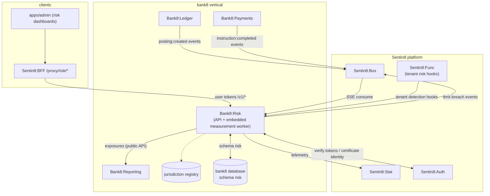

# Bank8:Risk - README

Prudential risk measurement: capital (Basel), liquidity (LCR/NSFR),
credit (IFRS 9 ECL), market, and operational risk, plus stress testing
and limit monitoring - a continuous measurement engine that consumes
posting/transaction events and emits limit-breach events, never moving
money itself.

## Summary

Bank8:Risk is a Rust service owning the `risk` schema in the bank8
vertical database. It continuously measures exposures, capital
components, liquidity buffers, expected credit losses, and stress
scenario outcomes from the events and balances Bank8:Ledger and
Bank8:Payments produce, monitors them against configured limits, and
emits `bank8:risk:limit:breached` events when a limit is crossed. It
feeds Bank8:Reporting (filing inputs) and is itself read via public API.

## Motivation

Risk obligations are continuous, not batch: capital adequacy, liquidity
coverage, credit loss, and limit headroom must be known at any moment,
not only at filing time. A dedicated measurement service keeps the
money-movement hot path (Ledger/Payments) free of risk computation,
and emits breaches as events so Compliance (alerting) and Reporting
(filing) react without a bespoke internal API.

## Architecture & High-Level Design

## Key Traits and Data Structures

- `RiskLimit` - a configured threshold (capital ratio, LCR, concentration,
  VaR) with breach state; crossing it emits `bank8:risk:limit:breached`.
- `Exposure` - a measured position (counterparty, currency, asset class)
  updated incrementally from posting events.
- `CapitalComponents` / `LiquidityBuffers` - Basel / LCR-NSFR bucket
  aggregations computed from the ledger.
- `EclModel` - IFRS 9 expected-credit-loss staging (12-month vs.
  lifetime) driven by credit events.

## Rationale, Trade-offs, and Alternatives

- **Event-driven measurement** - risk reacts to `bank8:ledger:posting:created`
  and `bank8:payments:instruction:completed` rather than polling; the
  event payload carries the full snapshot (account id + amount + posting
  id), minimizing read-back (principles §4.7, event-first).
- **Breach as an event, not a table poll** - limits are monitored
  incrementally; a breach is a domain event Compliance and Reporting
  both consume, never a shared table grant.
- **Jurisdiction drives thresholds** - capital/liquidity floors differ
  by regulator; they are registry data (CRR3/CRD6 output floor, OSFI
  CAR/LAR, US Basel III), not code.

See `DESIGN.md` for the wire-level detail and `BUSINESS.md` for the
business capabilities.

---

**Design attribution:** bank8:risk and its underlying concepts were designed by Hamid Jahanzad <Hamid@Jahanzad.com>.
